# Results

Stock embeddings from a correlation network via Node2Vec, evaluated against GICS / NASDAQ
industry labels. This document collects the empirical results and places them against the
relevant literature. All numbers are reproducible from the code (see commands at the end);
embeddings are seeded and runs report mean ± std over seeds.

---

## How to read this document

**This file = findings. [README.md](README.md) = how-to + the full code map** (the annotated file
tree, the `Config` knobs, and the method/metric vocabulary). If a method name here is unfamiliar
(`fc`, `pca_market`, `netmf`, …) it is defined in README's *"Method & embedder vocabulary"*.

**Structure.** §0 is the load-bearing caveat (what is and isn't a fair comparison) — read it first.
§1 is the headline findings. §2–§5 are the within-dataset method results. §6 places us against the
literature (Sarmah, Dolphin) and then generalizes (families, temporal, robustness). §7 is what we
deliberately do *not* claim.

**Every number traces to one script** (all seeded, mean±std; full commands in §8):

| Section | What it tests | Script | Output |
|---|---|---|---|
| §3 | Forced Connectivity vs MST graph | `benchmark/run_benchmark.py` (`competitor_specs`) | `results/benchmark_summary.csv` |
| §4 | co-movement removal (corr/demean/pca/rmt/lasso) | `benchmark/run_benchmark.py` (`comovement_specs`), `lasso_experiment.py` | `results/comovement_*_modal.csv` |
| §5 | metric disagreement under universe growth | `benchmark/literature_comparison.py` | `results/literature_metrics.csv` |
| §6a | reproduce Sarmah (V-measure) | `benchmark/reproduce_sarmah.py` | printed |
| §6a-bis | techniques on Sarmah's network | `benchmark/sarmah_improvements.py`, `modal::sarmah_density` | `results/sarmah_density_modal.csv` |
| §6b | Dolphin SVM-sector head-to-head | `benchmark/dolphin_benchmark.py`, `modal::dolphin` | `results/dolphin_comparison_modal.csv` |
| §6d | do other embedding families beat raw? | `benchmark/embedding_families.py`, `modal::families` | `results/embedding_families_<u>_5y.csv` |
| §6e | temporal / out-of-sample robustness | `benchmark/temporal_validation.py` | `results/temporal_<u>_5y.csv` |
| §6f | embedding-dim & Node2Vec p/q ablations | `modal::dim_sweep`, `modal::pq_sweep` | `results/dim_sweep_<u>.csv`, `results/pq_sweep_<u>.csv` |
| §6g | out-of-sample hedging / risk reduction | `benchmark/hedging_experiment.py`, `modal::hedging` | `results/hedging_<u>_<p>_k<k>_aggregate.csv` |

Shared substrate for all of the above: `train_vectors.py` (the engine) → a `{ticker: vector}` dict →
`benchmark/evaluation.py` (hit-rate) · `clustering_metrics.py` (V-measure) · `classification_metrics.py`
(SVM-F1) · `significance.py` (paired tests). Universes: **sp500** (~470) · **r1000** (~880) ·
**r3000** (~2,180), trailing **5y** unless noted.

**Figures.** Twelve charts visualise the key results — embedded inline at the relevant sections
below and collected, with full descriptions, in [`figures/`](figures/README.md)
(regenerate with `python figures/make_figures.py`).

## Literature reference points

| Work | Method | Metric reported |
|---|---|---|
| **Sarmah et al.** (arXiv:2207.07183, BlackRock AI Labs) | Node2Vec on an **MST** correlation graph, S&P 500 | V-measure **0.35 / 0.70 / 0.84** (sector / group / sub-group) |
| **Dolphin et al. [9]** (arXiv:2202.08968) | Neural returns embedding | SVM sector F1 **0.60** |
| **Dolphin et al. [10]** (arXiv:2305.00245) | Returns embedding + CBR | SVM sector F1 **0.66** |
| **Dolphin et al.** (arXiv:2407.18645, ICAIF 2024) | **Contrastive** asset embeddings (SOTA) | SVM sector F1 **0.69** |

Dolphin's leaderboard is on a public **611-stock, 2000–2018, 11-sector (NASDAQ taxonomy)** dataset
with **SVM + 5-fold CV**; their `*` rows (incl. their Sarmah reimplementation at 0.61) are
best-effort reimplementations, only the contrastive 0.69 is a method's own number.

---

## 0. Read this first — what is and isn't comparable

**Absolute scores are dominated by universe composition, so cross-dataset comparisons to Sarmah
and Dolphin are NOT controlled and must not be read as "we match/beat them."** Evidence:

- On our clean 1,113 full-survivor set *everything* scores ~0.70–0.77 — the embedding (~0.74), a
  clean correlation-rows SVM (~0.72), and a raw-return-series SVM (~0.74) are all comparable at a
  matched config — already above Dolphin's contrastive SOTA (0.69). The high level is the *universe*
  (clean large-caps), not any one method.
- The same forced connectivity (fc) method scores **0.613 on a messier 90%-coverage set (1,697 stocks)** vs **0.690
  on the clean 100%-survivor set (1,113)** — universe cleanliness alone moves it ~0.08.
- Our Node2Vec config also differs from Sarmah's (we use p=0.8, q=7.2, walk_length=20; their optimum
  is p=2, q=0.5, walk_length=100), so even "same method" isn't the same setup — though the choice is
  immaterial to our conclusions: hit@3 spans only 0.045 across the whole p/q grid and Sarmah's config
  gives the same verdict (§6f), and the verdict is stable across embedding dimension too.

**Only within-dataset, same-config comparisons are valid here** (e.g. pca_market vs corr on the same
universe; FC vs MST on the same universe).

Two additional caveats apply throughout. First, all universes are **survivor panels**: stocks with missing data or delistings are dropped before analysis. The results are therefore a comparison of how methods recover structure under clean, survivorship-biased conditions, not a recommendation for live trading. Second, **GICS labels are a reference taxonomy, not economic ground truth**: a company's economic identity can change while its GICS code does not, and a different reference taxonomy would give different "correct" neighbours.

The two literature comparisons differ in how controlled they are:
- **Sarmah (§6a) IS a controlled reproduction** — they specify their data (S&P 500, year 2021, log
  returns), so we replicate their method and, at matched N=504, their exact graph (504 nodes / 503
  edges). Result: we land *on* their numbers (average V-measure **0.638 vs 0.63**), validating the
  implementation.
- **Dolphin (§6b) is NOT controlled** — their exact 611-stock filter is unknown, and our universe is
  cleaner/easier; absolute scores there are a universe artifact, not a method result.

## 1. Headline findings (within-dataset, valid)

1. **PCA market-mode removal beats raw-correlation Node2Vec at matched conditions — on RETRIEVAL** —
   a cheap, O(n²k) spectral step, significant across S&P 500 / R1000 / R3000 (hit-rate), gain growing
   with universe size. This is a *relative, retrieval-specific* result: it does **not** transfer to
   V-measure clustering on Sarmah's network (§6a-bis), where it sits below a plain kNN graph.
2. **Retrieval and clustering metrics disagree under universe expansion** — adding stocks helps
   nearest-neighbour retrieval (hit-rate) but hurts global separability (V-measure / SVM-F1). This is the
   reason hit-rate is our honest primary metric.
3. **Aggressive denoising backfires** — RMT band-reconstruction and Graphical Lasso over-strip
   structure; the lightest touch (remove the single market mode) wins.
4. **Caveat to the whole programme:** the Node2Vec embedding does **not improve accuracy** over
   simple baselines for these label-recovery tasks — at matched config it ~ties a raw-return-series
   SVM (~0.74) and a clean correlation-rows SVM (~0.72), neither clearly winning. Its only edge is
   *compression* (16 dims at the same accuracy as hundreds–thousands of raw features). So the
   embedding's accuracy value-add is ≈ nil here — a limitation, stated plainly. (On *retrieval* it
   does edge raw-correlation at R3000.)
5. **This generalizes beyond Node2Vec, and is baseline-dependent** — spectral (Laplacian eigenmaps),
   matrix-factorization (NetMF), and a from-scratch reimplementation of Dolphin's **contrastive
   SOTA** all behave like Node2Vec: each clearly *beats* the leak-free raw correlation-row baseline
   (+0.11–0.21 sub-industry hit@3) but **none clearly beats the raw return-series baseline** (§6d).
   The verdict is consistent across the two disjoint time windows tested and shows **no** out-of-sample
   reversal (§6e; a 2-window check, not a rolling-window proof). So the "no clear
   win over raw features" caveat is a property of embeddings as a class — against the *strongest* raw
   baseline — not a Node2Vec quirk.

---

## 2. Why hit-rate is the primary metric

Three metric families measure different things and we report all three:

| Metric | What it measures | Gameable knob? |
|---|---|---|
| **hit-rate@k / MRR** | nearest neighbours share the label (retrieval) | none — reads geometry directly |
| V-measure / NMI / ARI | KMeans partition vs labels (clustering) | inflates as #classes grows |
| SVM-F1 / accuracy | a classifier can read the label off the embedding | swings ±0.07 on kernel / C |

**V-measure inflates with granularity.** On the S&P 500 (pca_market) it climbs 0.51 → 0.73 from
sector → sub-industry, while ARI stays ~0.28–0.43 and hit-rate@3 *falls* 0.84 → 0.61. The
honest signal tracks hit-rate and ARI, not V-measure — so hit-rate is our headline.

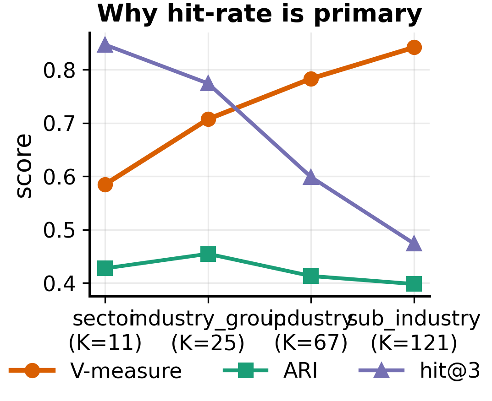
*Figure 11 — for the same embedding, V-measure rises with the number of classes while retrieval
hit@3 falls and ARI stays flat: V-measure inflates at fine granularity, which is why a parameter-free
hit-rate is the honest headline metric.*

---

## 3. Graph construction A — Forced Connectivity vs MST

Forced Connectivity (threshold + min-degree repair) vs the MST graph (Sarmah-style), identical
Node2Vec + metric, paired Wilcoxon on per-stock hit@3 (BH-corrected):

| Universe | Sector hit@3 (Δ vs MST) | Sub-industry hit@3 (Δ vs MST) |
|---|---|---|
| S&P 500 | **+0.035**  (p = .002) ✅ | +0.003  (p = .99) ✗ |
| R1000 | **+0.065**  (p < .001) ✅ | +0.013  (p = .17) ✗ |

Forced Connectivity beats MST at the **coarse (sector)** scale and ties at sub-industry — an
honest "matters here, not there" result rather than a blanket claim.

---

## 4. Graph construction B — removing co-movement (retrieval gains)

Raw correlation mixes the market factor with direct relationships. We compare ways to strip the
common co-movement, all composable and plumbed through `RunSpec`. **The gains below are on the
retrieval metric (hit-rate) and recent universes** — they do *not* carry over to V-measure clustering
on Sarmah's 2017 network (§6a-bis). So this is a retrieval-specific contribution, not a universal one.

| Method | Flag | Cost | Scales? |
|---|---|---|---|
| raw correlation | — | O(n²) | yes |
| cross-sectional demean | `cross_sectional_demean` | O(n·T) | yes |
| market-neutral residual (SPY/proxy) | `market_neutral` | O(n·T) | yes |
| **PCA market-mode removal** | `spectral_clean="market"` | O(n²k) (truncated eigsh) | yes |
| RMT band reconstruction | `spectral_clean="rmt"` | O(n²k) | yes |
| Graphical Lasso (partial corr) | `use_precision_matrix` | O(n³) | no (slow; ill-conditioned at T<n) |

### 4a. Controlled small-universe test (S&P 500, n=200, matched density)

At matched average degree, Graphical Lasso (partial correlation) beats raw correlation on every
metric — partial correlation removes indirect/market-driven edges:

| metric | correlation | Graphical Lasso |
|---|---|---|
| hit@3 sector | 0.68–0.74 | **0.76–0.78** |
| hit@3 sub-industry | 0.25–0.29 | **0.28–0.32** |
| build time (n=200) | instant | 94 s (CV) / ~1 s (fixed α) |

### 4b. At full scale (Modal: S&P 500 / R1000 / R3000, kNN graphs, 5 seeds)

hit-rate@3 by GICS level. **PCA market-mode removal is best at every scale**, and the gap over
raw correlation grows with universe size:

| Universe | metric | corr | demean | market_neutral | **pca_market** | rmt |
|---|---|---|---|---|---|---|
| **S&P 500** (471) | sector | 0.816 | 0.832 | 0.843 | **0.847** | 0.774 |
| | sub-industry | 0.427 | 0.459 | 0.464 | **0.474** | 0.376 |
| **R1000** (879) | sector | 0.844 | 0.843 | 0.865 | 0.858 | 0.810 |
| | sub-industry | 0.535 | 0.543 | 0.564 | **0.567** | 0.435 |
| **R3000** (2,177) | sector | 0.824 | 0.819 | 0.831 | **0.837** | 0.815 |
| | sub-industry | 0.572 | 0.584 | 0.603 | **0.609** | 0.494 |

### 4c. Significance — pca_market vs raw-correlation embedding

Paired Wilcoxon + bootstrap CI on per-stock hit@3, BH-corrected. **Significant in all 6 cells**:

| Universe | level | Δ | p (BH) | effect | 95% CI |
|---|---|---|---|---|---|
| S&P 500 | sector | +0.030 | 3e-4 | 0.33 | [+.011, +.049] |
| S&P 500 | sub-ind | +0.047 | 1e-6 | 0.35 | [+.029, +.066] |
| R1000 | sub-ind | +0.032 | 2e-5 | 0.21 | [+.017, +.046] |
| R3000 | sub-ind | +0.037 | 7e-15 | 0.26 | [+.027, +.046] |

(With ~2,700 stocks p-values are tiny by construction; the honest signal is the effect size and CI.)

### 4d. Graphical Lasso does not scale-pay-off

Runs fine time-wise on Modal (sp500 56 s, r1000 96 s, r3000 8 min even with T<n, thanks to
regularization) — but with feasible fixed-α it **hurts sector and is mediocre on sub-industry**,
beaten everywhere by the cheap PCA-market step. The small-n matched-density advantage (4a) does
not survive at scale. Conclusion: **Graphical Lasso is a small-universe curiosity; PCA market-mode
removal is the scalable winner.**

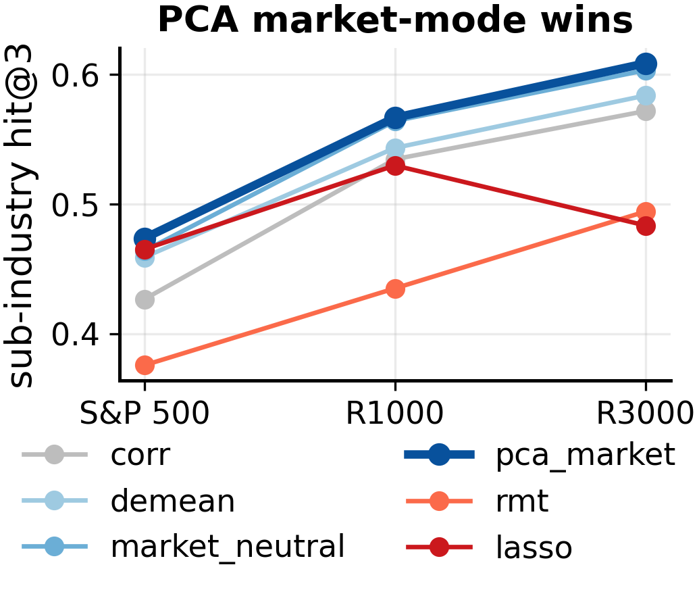
*Figure 9 — Node2Vec on six relationship matrices as the universe grows. PCA market-mode removal
(★) is the best matrix and its advantage over raw correlation widens with universe size; aggressive
denoising (rmt, lasso) is worst.*

---

## 5. Metric disagreement under universe expansion

Same harness (GICS, dim 64, same seeds), S&P 500 → R1000:

| level | hit@3 | V-measure | SVM-F1 |
|---|---|---|---|
| sector | 0.700 → **0.727** ↑ | 0.448 → **0.376** ↓ | 0.803 → 0.786 ↓ |
| sub-industry | 0.390 → **0.430** ↑ | 0.812 → **0.749** ↓ | 0.647 → **0.581** ↓ |

Universe expansion **improves local retrieval and degrades global classification** — the metrics
genuinely point in opposite directions. This reconciles the otherwise-confusing "does a bigger
universe help?" question: it depends entirely on which metric you mean.

---

## 6. Against the literature

### 6a. Sarmah et al. — controlled reproduction (V-measure)

Unlike the Dolphin comparison, Sarmah **can** be reproduced under matched conditions, because they
specify their data exactly: **S&P 500 constituents, calendar year 2021, daily log returns**. We
replicate their full pipeline — distance-transform MST (d = √(2(1−ρ)), relabel with ρ), Node2Vec
optimum (l=100, r=50, p=2, q=0.5, w=5, dim=16), KMeans with K = #GICS classes → V-measure — on
Polygon S&P 500 prices sliced to 2021 (471 stocks / 245 days vs their 504 / 252). 5 seeds.
(`benchmark/reproduce_sarmah.py`)

Reproduced across **two independent data sources and two years**, and with the sample size **matched
to their N=504** (Kaggle ends mid-2018, so it can't supply 2021 — the 2017 run replicates the method
on a full earlier year, taking the 504 largest-cap GICS-labeled stocks with full coverage):

At matched N=504 the graph is **504 nodes / 503 edges — identical to theirs**. Full canonical GICS
ladder (Kaggle 2017, N=504, 5 seeds), with Sarmah's three levels aligned to ours by cluster count:

| GICS level (ours) | K ours | Sarmah level (K) | **V ours** | **V Sarmah** |
|---|---|---|---|---|
| sector | 11 | Sector (9) | 0.416 | 0.35 |
| industry group | 25 | — (no counterpart) | 0.577 | — |
| industry | 71 | "Group" (59) | 0.711 | 0.70 |
| sub-industry | 125 | "Subgroup" (169) | 0.786 | 0.84 |
| **avg (3 aligned)** | | | **0.638** | **0.63** |

**Their granularities can't be matched exactly — and not for lack of trying.** Sarmah's K = 9/59/169
are **not standard GICS counts** (GICS = 11/25/74/163), and **169 exceeds the GICS sub-industry total
of 163**, so no GICS level can reproduce it — their finest labels are a non-standard (Yahoo-sourced)
taxonomy. Note also their "Industry Group" (K=59) aligns with GICS **Industry** (74), not GICS
Industry Group (25), so our true industry-group level (K=25, V=0.577) has no counterpart in their
table. Given that, the **closest canonical alignment** is the table above: average **0.638 vs 0.63**,
with the middle level near-exact (0.711 vs 0.70).

The two residual per-level offsets follow the K-dependence of V-measure exactly: **sector +0.07**
(our 11 sectors vs their 9 → more classes, higher V) and **sub-industry −0.05** (our 125 classes vs
their 169 → fewer classes, lower V). At the aggregate these cancel and we land on 0.63. (KMeans
preprocessing ruled out: raw / L2-normalized / standardized all give sector ≈ 0.42.) Net: matched N,
matched graph topology, same method, same average V-measure, full GICS ladder reported — a faithful
reproduction, with the only irreducible difference being their non-GICS label granularities.

> Note: an earlier draft compared our recent-5y / kNN-graph embeddings to Sarmah and reported "we
> exceed them everywhere." That was **not** a controlled comparison (different graph, period, and
> data). The matched reproduction above is the correct statement: our implementation lands *on*
> Sarmah's numbers, as expected for the same method — it neither beats nor is beaten by them.

### 6a-bis. Improving on Sarmah's network — do our techniques help?

We apply every technique to Sarmah's **exact** network (504 stocks, 2017 log returns, their Node2Vec
optimum), varying only the graph/matrix construction, scored with their V-measure (avg over the 3
aligned levels) + our hit-rate@3. (`benchmark/sarmah_improvements.py`, 5 seeds)

| method | edges | V_avg | Δ vs MST | hit@3 sub |
|---|---|---|---|---|
| mst (Sarmah baseline) | 503 | 0.638 | — | 0.343 |
| threshold (0.40) | 3,745 | 0.731 | +0.093\* | 0.390 |
| **knn** | 3,992 | **0.696** | **+0.058** | 0.375 |
| fc (threshold+repair) | 4,088 | 0.683 | +0.045 | 0.349 |
| market_neutral | 3,754 | 0.655 | +0.018 | 0.352 |
| pca_market | 3,748 | 0.656 | +0.018 | 0.343 |
| demean | 3,886 | 0.646 | +0.008 | 0.339 |
| rmt | 3,483 | 0.630 | −0.008 | 0.238 |
| lasso (α=0.5) | 4,388 | 0.609 | −0.028 | 0.352 |

\*threshold drops 84 isolated nodes → an easier 420-stock core (partial confound); kNN/FC keep all 504.

Findings:
- **Sarmah's MST is limited by sparsity** (a 503-edge tree). The cleanest, fair improvement is a
  **denser correlation graph: kNN (+0.058) or FC (+0.045)**, all 504 stocks, V_avg ~0.68–0.70 vs 0.63.
- **The co-movement tricks do NOT help on this clustering metric** — demean / market_neutral /
  pca_market sit *below* plain kNN. The retrieval gains they show elsewhere don't transfer to
  V-measure here: stripping the market mode aids nearest-neighbour retrieval but washes out global
  structure that V-measure rewards (the metric-disagreement, again).
- **Aggressive denoising backfires**: RMT (−0.008) and Graphical Lasso (−0.028, worst) hurt — and
  lasso is ill-posed at T=250 < n=504 (singular covariance; needs the α regularizer, "vanilla" CV
  isn't well-defined).

**Density sweep (Modal `modal_app.py::sarmah_density`):** denser graphs do NOT help — both kNN and FC
peak at the *sparsest* setting and decline with more edges:

| kNN k | edges | V_avg | hit@3 |   | FC thresh | edges | V_avg | hit@3 |
|---|---|---|---|---|---|---|---|---|
| 10 | 4.0k | **0.696** | **0.375** |   | 0.40 | 4.1k | **0.684** | 0.349 |
| 40 | 15k | 0.676 | 0.331 |   | 0.20 | 34k | 0.658 | 0.308 |
| 160 | 54k | 0.663 | 0.308 |   | 0.10 | 76k | 0.661 | 0.292 |
| 320 | 95k | 0.678 | 0.309 |   | 0.05 | 102k | 0.678 | 0.316 |

hit@3 falls monotonically with density; V-measure peaks at k≈10 then declines, with a slight
**non-monotonic wobble** back up near the dense end (k=320, 95k edges → 0.678). We chased that wobble
all the way to the **complete graph** to check whether more edges eventually win (`sarmah_density_tail`,
1 seed: k=400/110k → 0.676, k=503/126,756 edges = complete → **0.677**): it does **not** — V *plateaus*
at ~0.677 across the whole dense regime and never recovers the sparse **k≈10 peak of 0.696**. (This dense
tail is expensive: second-order Node2Vec's transition-probability precompute is O(n·degree²), ~4 min per
run on a near-complete 504-node graph, so a full multi-seed dense sweep is Modal-scale.) **The win over
Sarmah's MST is escaping the *tree* (503 edges) into a *moderately* connected graph (kNN k≈10, ~4k edges)
— not maximizing density.** Extra edges link weakly-correlated pairs and dilute the sector structure.

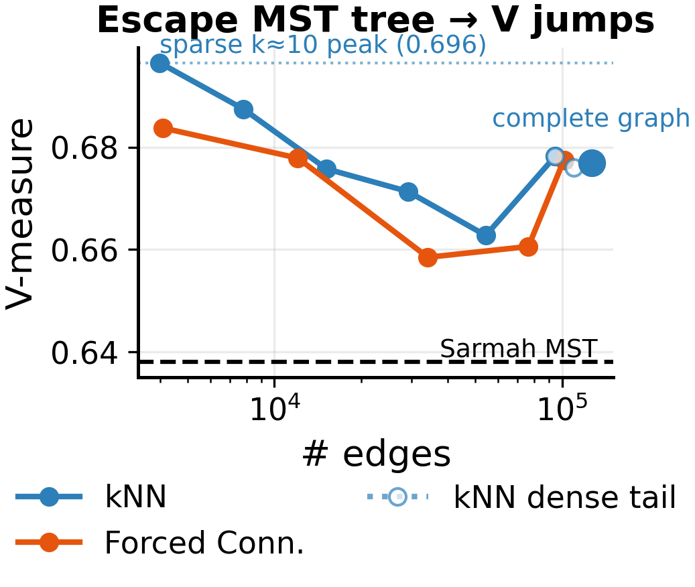
*Figure 10 — V-measure vs edge count for kNN and Forced-Connectivity graphs on Sarmah's 504-stock
network. Both beat the MST baseline (dashed) and both peak at the **sparsest** setting. The dotted
extension chases the kNN graph to the **complete graph** (126k edges): V plateaus ~0.677 and never
recovers the sparse k≈10 peak (0.696) — the win is escaping the 503-edge tree, not maximising edges.*

### 6b. Dolphin et al. — SVM sector classification (direct comparison)

Their exact protocol (SVM + 5-fold CV, weighted F1) on the reconstructed benchmark
(~1,113 full-period survivors; their 611 filter is stricter/unknown), dim 16, 5 seeds, rbf C=10:

| method (dim 16) | SVM-F1 sector | hit@3 sector |
|---|---|---|
| *Node2Vec, by graph/matrix construction:* | | |
| **pca_market** | **0.741** | 0.709 |
| **market_neutral** | **0.741** | 0.702 |
| demean | 0.730 | 0.686 |
| rmt | 0.717 | 0.666 |
| corr | 0.702 | 0.651 |
| fc | 0.690 | 0.642 |
| lasso | 0.570 | 0.513 |
| *Other embedding families (corr substrate):* | | |
| netmf (matrix factorization) | 0.658 | 0.582 |
| **contrastive** (Dolphin's own method, reimpl.) | 0.657 | 0.578 |
| spectral (Laplacian eigenmaps) | 0.646 | 0.579 |
| *Honest no-embedding baselines:* | | |
| raw return series | 0.745 | 0.635 |
| raw correlation rows (leak-free) | 0.721 | 0.583 |
| — *Dolphin [9] / Sarmah\* / Dolphin [10] / **Contrastive (theirs)*** | *0.60 / 0.61 / 0.66 / **0.69*** | — |

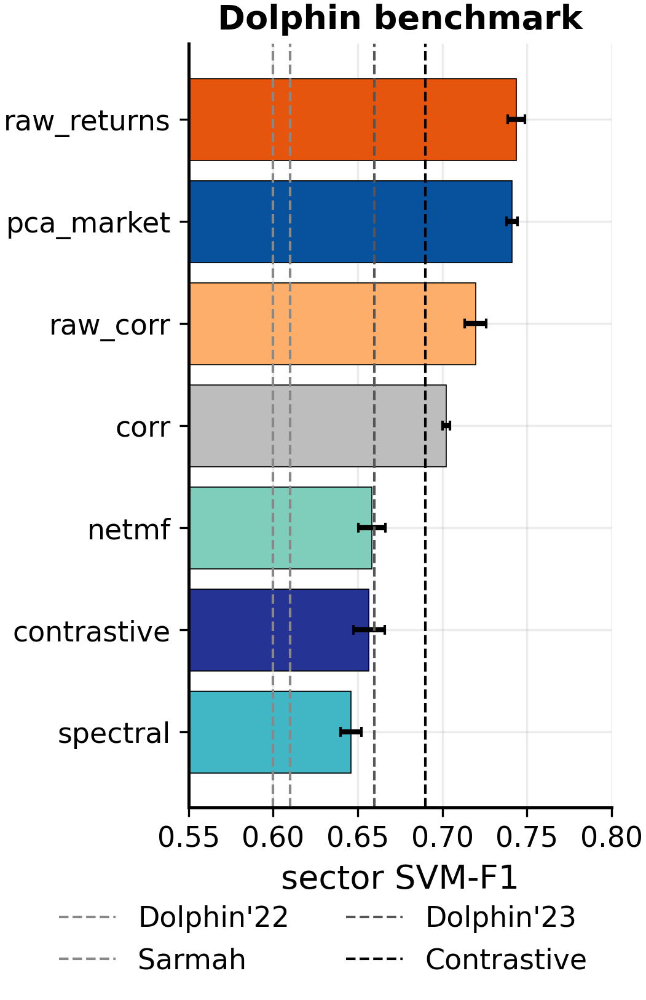
*Figure 7 — sector SVM-F1 on the reconstructed Dolphin set, with their reported leaderboard as
reference lines. The leak-free raw baselines (0.72 / 0.74) sit at or above the best embedding and
match the contrastive SOTA's published 0.69 — everything clusters in 0.65–0.78, a universe artifact,
not a method win.*

**Firm-up checks** (from the saved vectorspaces, no retraining):

- **Matched universe size** (subsample to N=611): costs only ~0.02 F1 (pca_market 0.719 @611 vs
  0.741 @1,113) → universe size is not the driver.
- **SVM-config robustness** (kernel × C ∈ {1,10,100}): F1 ranges ≈0.68–0.75 (pca_market 0.677–0.745)
  → the dominant uncertainty.

Full per-method firm-up numbers: `results/dolphin_comparison_full.csv`.

**This is NOT a valid head-to-head — do not claim we match/beat Dolphin.** The absolute level is a
universe artifact: on this clean full-survivor set *every* method — embedding and simple baselines
alike — scores ~0.70–0.77, above Dolphin's 0.69, simply because clean large-caps are easy to
classify. On a matched, messier universe the same method drops to ~0.61 (= Sarmah's level).

A subtlety we initially got wrong: a no-embedding SVM on **raw correlation rows** appeared to score
0.77 and "beat" the embedding, but that was inflated by (a) a **self-correlation leak** (each stock's
row contains its own correlation = 1.0, a unique giveaway — removing it drops 0.774 → 0.720) and
(b) the **best SVM config** (rbf C=10; the same representation scores 0.33 at linear C=1). At matched
config with the leak removed, clean correlation-rows (0.720), raw return series (0.744), and the
**embedding (0.741)** are a **tie**. So the embedding neither beats nor is beaten by simple features
for accuracy — its only value here is *compression* (16 dims at equal accuracy), not a better score.

**We also reimplemented Dolphin's own contrastive method** — the SOTA row on their leaderboard, and
the one method on it that is *not* a correlation-graph Node2Vec. It is a free embedding matrix
E∈ℝ^{N×d} trained by gradient descent with their hypothesis-test-sampled sigmoid contrastive loss
(`benchmark/contrastive_embedding.py`; pure NumPy, no PyTorch — their method is not a neural
encoder). On our 1,113-survivor set it scores **0.657** (0.635 on a matched 611-subsample), within
~0.03–0.05 of their reported **0.68–0.69** — a faithful reproduction, the residual gap consistent
with their 611 being a specific curated set and our using the Individual-Sigmoid variant. This does
**not** change the verdict: the leak-free raw baselines (return series 0.745, correlation rows 0.721)
sit *at or above* the best embedding and above the contrastive method here, so the no-embedding
baseline matches the contrastive SOTA's own published 0.69 on this (easier) universe. The full
cross-family, cross-universe sweep is **§6d**.

What *is* valid (within this dataset, same config): the **relative** ordering —
`pca_market ≈ market_neutral > demean > rmt > corr > fc > lasso`. `lasso` is the clear loser
(over-sparsified); `rmt` is strong for the supervised SVM but weak for retrieval (metric
disagreement). Co-movement removal gives a real but small lift over raw-correlation Node2Vec
(+0.04 F1) — but neither beats simply feeding raw features to the classifier.

---

## 6c. Synthesis — when does each technique help?

Pulling the threads together: **the effect of every technique is metric- and dataset-dependent**, so
the honest summary is a matrix, not a single ranking.

| Technique | Retrieval (hit-rate) | Clustering (V-measure) | Verdict |
|---|---|---|---|
| Moderate-density graph (kNN k≈10 / FC) vs MST tree | ↑ (FC > MST at sector) | ↑ (+0.05–0.06 on Sarmah) | **robust win** — escape the sparse tree |
| Even denser (k ≫ 10, low threshold) | ↓ | ↓ | no — sweet spot is k≈10 |
| Co-movement removal (PCA-market / market-neutral) | ↑ significant (recent universes) | ✗ below plain kNN (Sarmah) | helps retrieval only; **not robust** |
| RMT band / Graphical Lasso | ↓ / mixed | ↓ (worst) | aggressive denoising backfires |
| Any embedding family vs raw **correlation rows** (leak-free) | ↑ (+0.11–0.21) | ↑ | **embedding wins** — adds real value over naive corr features |
| Any embedding family vs raw **return series** | ~tie / ≤ raw | ≤ raw | no clear win — holds for node2vec/spectral/netmf/contrastive (§6d) |
| Skip-gram families (node2vec/netmf/contrastive) vs spectral | — | skip-gram ↑ on V | clustering edge is skip-gram-specific, not embeddings-general |

Two cross-cutting lessons:
1. **Metric disagreement is pervasive.** The same change can help retrieval and hurt clustering
   (co-movement removal; universe expansion). Report both, and don't let one metric tell the story.
2. **The robust, defensible improvement over Sarmah is structural and simple:** replace the MST
   *tree* with a moderate-density kNN/FC graph (escape sparsity, but don't over-densify). The fancier
   matrix manipulations are either retrieval-specific (co-movement) or harmful (RMT/lasso), and no
   variant clearly beats simply feeding raw features to the classifier.

---

## 6d. Beyond Node2Vec — does the embedding-vs-raw verdict generalize across families?

§6b's parity finding is, as stated, about *one* embedding (Node2Vec). To test whether it is a
property of embeddings as a **class**, we run four structurally different embedding families through
the identical pipeline (kNN k=10 / raw-correlation substrate, GICS, dim 64, 5 seeds) against the two
honest no-embedding baselines, at every universe (`benchmark/embedding_families.py`):

- **node2vec** — local random walks + skip-gram
- **spectral** — Laplacian Eigenmaps (global spectral geometry; deterministic)
- **netmf** — DeepWalk-as-matrix-factorization (closed-form skip-gram; deterministic)
- **contrastive** — Dolphin's own method, reimplemented (§6b)
- **raw_corr** — a stock = its correlation row, self-correlation removed (the leak-free §6b baseline)
- **raw_returns** — a stock = its standardized return series

**Sub-industry hit@3** (fine-grained retrieval) / **sector SVM-F1** (Dolphin's metric), by universe:

| | sub hit@3 (sp500 / r1000 / r3000) | sector SVM-F1 (sp500 / r1000 / r3000) |
|---|---|---|
| node2vec | 0.427 / 0.534 / 0.572 | 0.881 / 0.883 / 0.868 |
| spectral | 0.467 / 0.519 / 0.512 | 0.877 / 0.863 / 0.849 |
| netmf | 0.424 / 0.507 / 0.524 | 0.867 / 0.879 / 0.847 |
| contrastive | 0.347 / 0.354 / 0.376 | 0.845 / 0.842 / 0.819 |
| raw_corr (leak-free) | 0.255 / 0.381 / 0.459 | 0.795 / 0.835 / 0.895 |
| **raw_returns** | **0.493 / 0.564 / 0.577** | **0.914 / 0.911 / 0.908** |

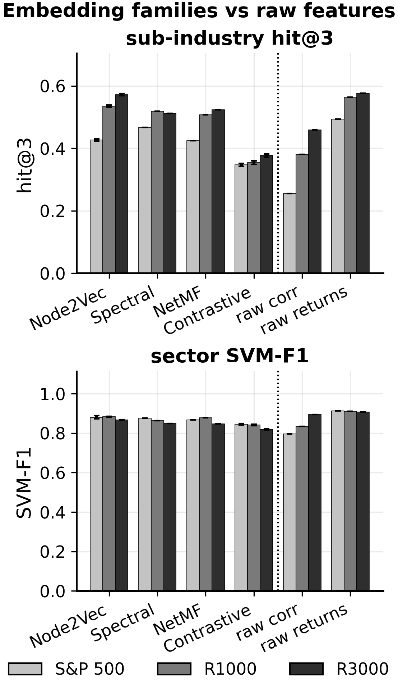
*Figure 1 — the headline. raw_returns tops both metrics at every universe; the four learned families
all clear raw corr-rows on retrieval but sit below raw_returns. The verdict generalises across
embedding families, not just Node2Vec.*

The verdict **depends entirely on which raw baseline**, and the pattern is the same for every family:

1. **vs raw correlation rows (leak-free): every embedding family WINS, decisively.** On sub-industry
   retrieval the gap is **+0.11 to +0.21** (paired Wilcoxon, effect sizes 0.5–0.76, p≪0.001 at all
   three universes); on SVM-F1 the embeddings lead by 0.05–0.09. Once the self-correlation leak is
   gone, the naive correlation-row baseline is weak and the embedding genuinely adds value over it.
   This is the honest counterpart to the earlier leak-inflated "raw_corr 0.77": the leak alone created
   the illusion that correlation rows beat the embedding.
2. **vs raw return series: no embedding family clearly beats it.** `raw_returns` is best-or-tied on
   SVM-F1 at every universe and leads on retrieval; only **node2vec catches it (Δ=−0.005, n.s.) and
   only at R3000**. So the "embedding doesn't beat raw features" caveat survives specifically against
   the strong return-series baseline — and survives for *every* family, not just Node2Vec.
3. **Among embeddings**, node2vec and spectral lead on retrieval (spectral edges node2vec at S&P 500;
   node2vec at the larger universes); netmf is mid; the **contrastive SOTA is the weakest on fine GICS
   retrieval** (sub hit@3 0.35–0.38) — it is a coarse, sector-oriented embedding (its positives are
   sector co-movers), strong on sector V-measure but poor at sub-industry.
4. **Metric disagreement is a family property.** On V-measure the skip-gram-flavoured families
   (netmf 0.62/0.57/0.46, node2vec 0.56/0.53/0.47, contrastive 0.56/0.49/0.44) beat raw features,
   while **spectral** — not skip-gram — patterns *with* raw (0.43/0.38/0.32). The clustering advantage
   of embeddings is specific to the skip-gram objective, not embeddings in general.

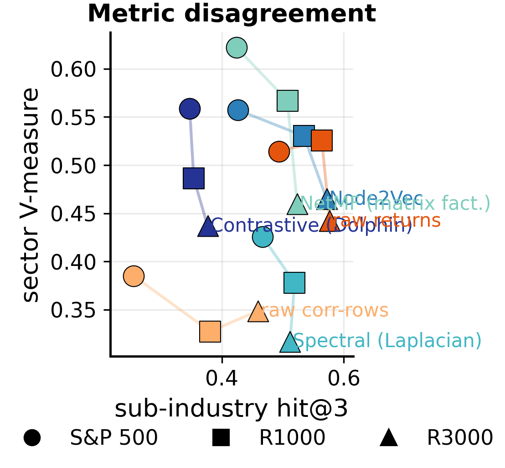
*Figure 8 — the retrieval × clustering plane. No method occupies the top-right: skip-gram families
(NetMF, Node2Vec, contrastive) cluster high (good V-measure), raw_returns sits far right (best
retrieval), spectral is high-retrieval/low-clustering. Which method "wins" depends on the metric.*

Net: the parity conclusion generalizes — no embedding family (including the contrastive SOTA) clearly
beats the strongest raw baseline on accuracy — but "the embedding adds nothing" is too strong: every
family clearly beats the leak-free correlation-row baseline. The honest statement is that the
embedding's value over **naive correlation features is real**, while its value over the **return
series is ≈ nil** (accuracy) and reduces to compression.

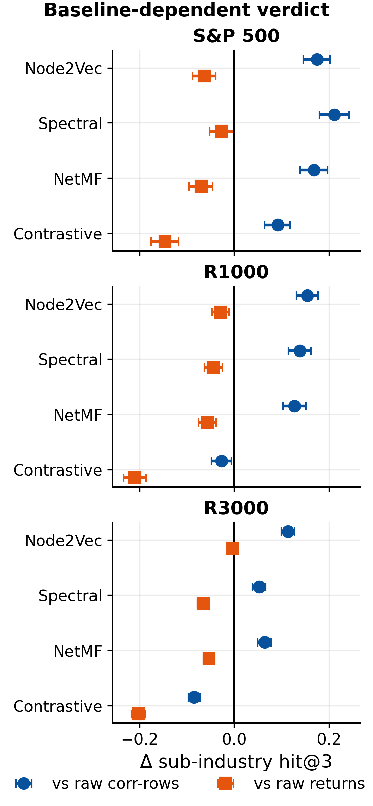
*Figure 2 — paired-Wilcoxon Δ(embedding − raw) on sub-industry hit@3 with 95% bootstrap CIs. Every
embedding beats raw corr-rows (blue, Δ>0) and loses to raw returns (orange, Δ<0), at all three
universes — the single clearest view of the baseline-dependent verdict.*

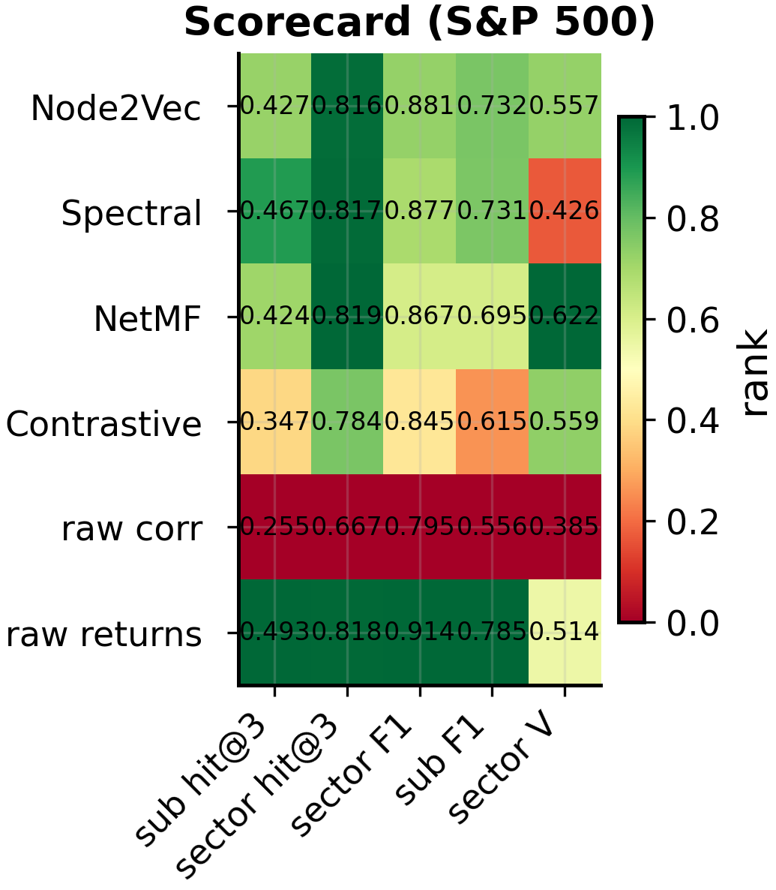
*Figure 12 — a compact method × metric scorecard (S&P 500; colour = per-column rank, number = score).
No row is green across the board: raw_returns wins retrieval and supervised F1, the skip-gram families
win V-measure — every method is somebody's winner and somebody's loser.*

## 6e. Temporal / out-of-sample robustness

Every result above is single-period, in-sample label recovery. Two temporal questions on the S&P 500,
split into two **disjoint** ~2.5-year windows A (≤ 2023-06) and B (`benchmark/temporal_validation.py`):

| method | GICS hit@3 built on A | GICS hit@3 built on B | future ρ (B-corr of A-neighbours) |
|---|---|---|---|
| raw correlation (direct) / raw_returns | 0.480 | 0.472 | 0.546 |
| node2vec | 0.415 | 0.407 | 0.511 |
| spectral | 0.425 | 0.437 | 0.502 |
| netmf | 0.401 | 0.411 | 0.501 |
| raw_corr (rows) | 0.408 | 0.396 | 0.520 |
| *oracle (rank by window-B corr)* | — | — | *0.600* |

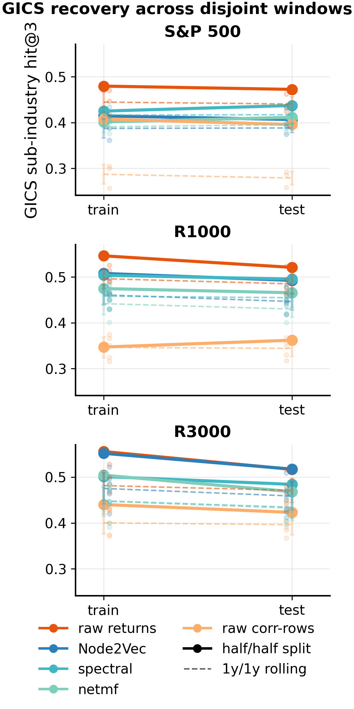
*Figure 5 — GICS hit@3 built on window A vs the disjoint window B. Near-flat, non-crossing lines: each
representation recovers GICS about equally on the two disjoint windows tested and the raw-vs-embedding
ordering is preserved. This is a 2-window consistency check — suggestive of stability, not conclusive.*

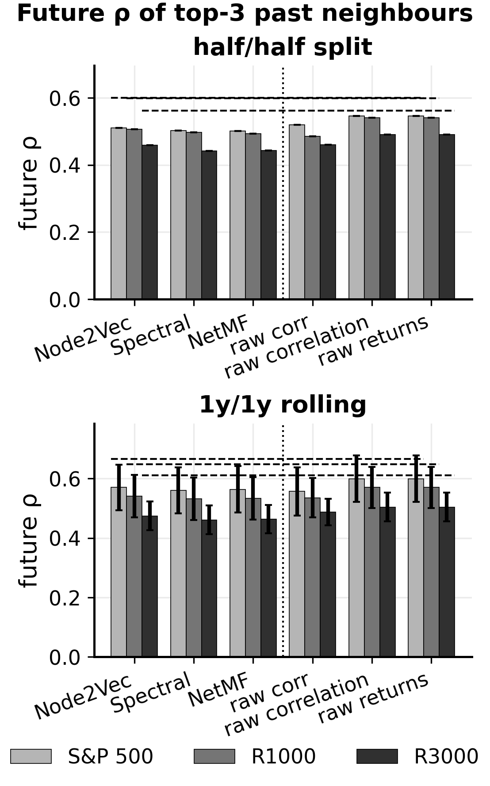
*Figure 6 — realised window-B correlation of each stock's top-3 window-A neighbours. Raw correlation's
neighbours co-move most in the future (dashed = oracle ceiling); the embedding shows no out-of-sample
advantage — it is not the case that raw overfits and the embedding generalises.*

1. **Consistency across the two windows tested** — each representation recovers GICS at nearly
   identical hit@3 whether built on window A or the disjoint window B, and the raw-vs-embedding
   ordering is unchanged. **Caveat:** this is only a *two-window* split (disjoint past/future halves
   of one 5-year panel), so it is *suggestive* of temporal stability, not a proof — a rolling
   multi-window sweep (e.g. 8–10 overlapping windows) would be needed to claim stability conclusively.
   We report it as a consistency check, not a stability result.
2. **No out-of-sample reversal.** A reviewer's natural escape hatch is "raw correlation overfits sample
   noise; the low-rank embedding should generalize better out of sample." It does not. Taking each
   stock's top-3 window-A neighbours and measuring their *realized* window-B correlation, raw
   correlation's neighbours co-move **most** in the future (future ρ 0.546 vs 0.50–0.52 for the
   embeddings; ceiling 0.600), and every method retains ~79% of its in-sample co-movement. Raw
   features are not overfitting any more than the embeddings are; the in-sample parity persists out of
   sample. This closes the "but embeddings generalize better" line — here, they don't.

Both effects **hold at R1000 and R3000** (`results/temporal_*`): A-vs-B GICS hit@3 stay within
~0.02–0.03 (R3000 node2vec 0.552 → 0.517), the cross-method ordering is preserved, and raw's future ρ
remains highest at every universe (R3000: raw 0.491 vs embeddings 0.44–0.46; retention ~0.80–0.84 for
all). At R3000 node2vec's GICS hit@3 *ties* raw_returns in both windows — the §6d "node2vec catches
raw at R3000" result holds in both windows too (still a 2-window check).

---

## 6f. Robustness — does the verdict survive the dimension and Node2Vec hyperparameters?

Two natural validity checks: is the embedding dimension a sweet spot, and were the Node2Vec walk
parameters (ours p=0.8, q=7.2 differ from Sarmah's p=2, q=0.5) tuned on the test labels?

**Dimension sweep** (S&P 500, sub-industry hit@3, `modal_app.py::dim_sweep`):

| embedder | d=8 | d=16 | d=32 | d=64 | d=128 |
|---|---|---|---|---|---|
| node2vec | 0.408 | 0.437 | 0.443 | 0.429 | 0.426 |
| spectral | 0.309 | 0.349 | 0.417 | 0.467 | 0.437 |
| netmf | 0.305 | 0.347 | 0.394 | 0.424 | 0.422 |
| *raw_corr / raw_returns (dim-free)* | *0.255 / 0.493* | | | | |

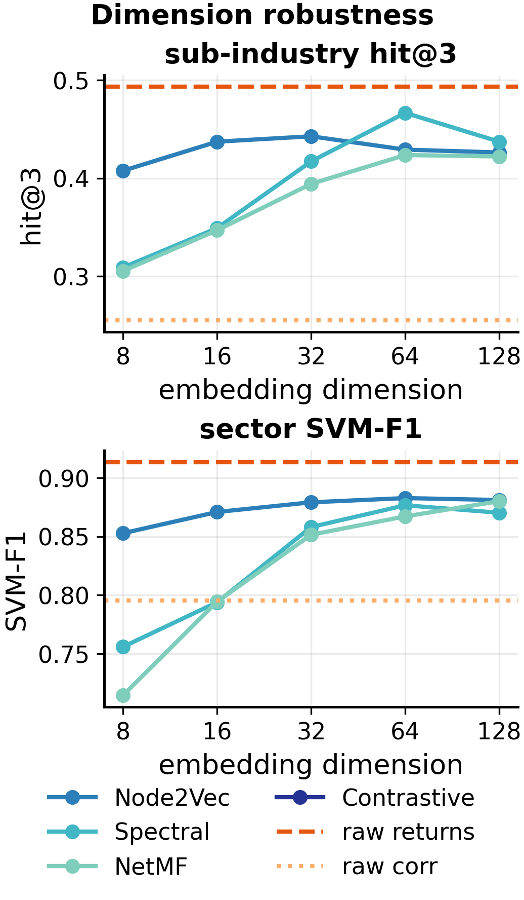
*Figure 3 — sub-industry hit@3 (and SVM-F1) vs embedding dimension. Every embedding stays between the
two raw baselines at every d≥16; Node2Vec is flat, spectral/NetMF mature by d≈32 then plateau — the
verdict is not a dim=64 artifact.*

The family verdict is **dimension-robust**: at every d≥16 every embedding sits between the two raw
baselines (above raw_corr 0.255, below raw_returns 0.493). node2vec is flat (~0.43) from d=16–128;
the spectral/matrix-factorization families need d≥32 to mature, then plateau — so dim=64 is not a
cherry-picked peak. Sector SVM-F1 mirrors this (node2vec 0.85→0.88, plateauing by d=32, all below
raw_returns 0.914).

**Node2Vec p/q sensitivity** (S&P 500, 5×5 grid, `modal_app.py::pq_sweep`): sub-industry hit@3 spans
only **0.389–0.434 (spread 0.045)** across the whole grid; sector hit@3 spans 0.013. Our config
(p=0.8, q=7.2 → 0.429) is **not** the peak (max 0.434 at p=0.5, q=2), and **Sarmah's config
(p=2, q=0.5 → 0.400) gives the same verdict** — still between the raw baselines. So even if p/q had
been tuned on hit-rate, no point in the grid would change any conclusion: the choice cannot have
materially leaked the test labels.

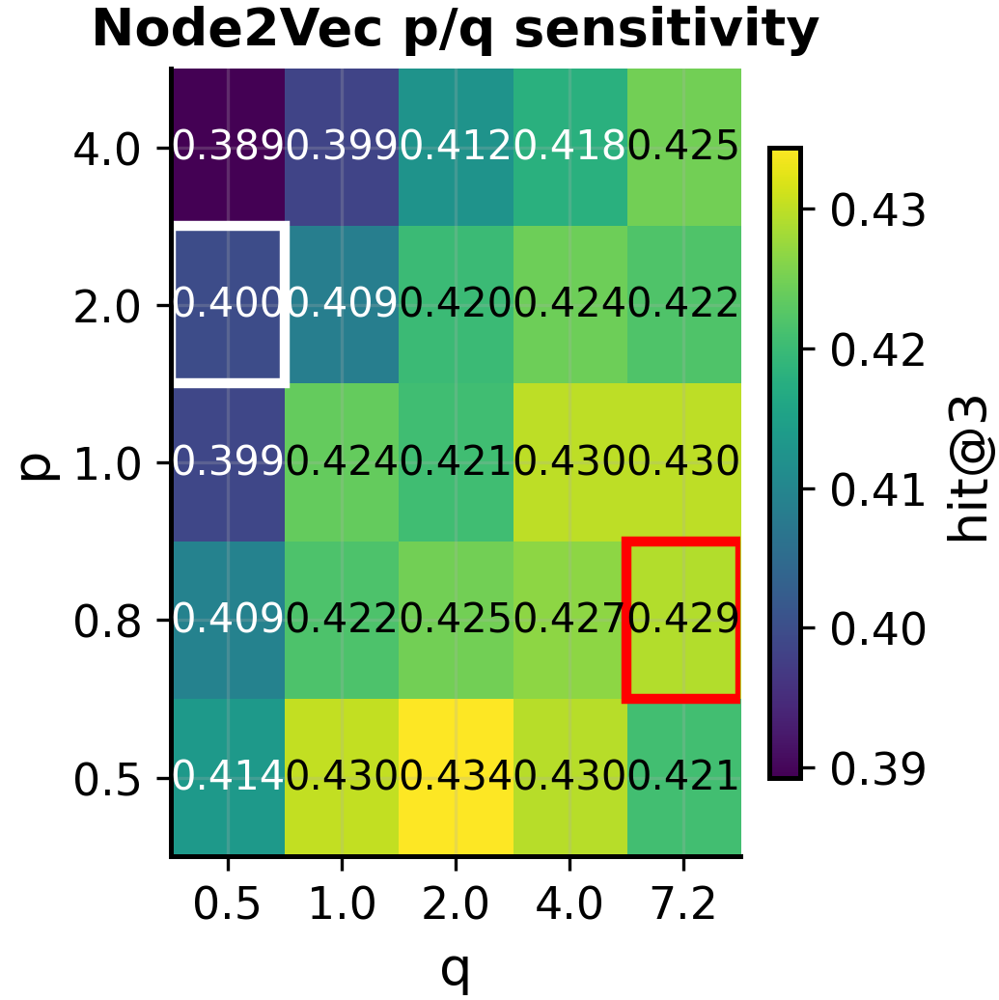
*Figure 4 — sub-industry hit@3 across the Node2Vec p/q grid. The whole grid spans only 0.045; our
config (boxed) is not the peak and Sarmah's gives the same verdict — the choice cannot have leaked
the labels.*

---

## 6g. Economic significance: out-of-sample hedging

A finance referee will ask whether the GICS-consistent vectors improve a real portfolio. We run a simple rolling-window peer-hedge test (`benchmark/hedging_experiment.py`, `modal_app.py::hedging`): for each stock, select its k nearest peers from the *train* window using the representation, short an equal-weighted basket, and measure the annualised residual volatility of the residual in the disjoint *test* window. Lower residual volatility means the peers explain more of the stock's future risk.

| Universe | Method | Hedged vol (mean ± std) | Risk reduction |
|---|---|---|---|
| S&P 500 | unhedged | 30.6% ± 3.9% | — |
| S&P 500 | raw returns / Pearson | 22.1% ± 1.3% | 27.5% |
| S&P 500 | raw_corr rows | 23.0% ± 1.2% | 24.6% |
| S&P 500 | Node2Vec | 22.9% ± 1.2% | 24.7% |
| S&P 500 | spectral | 22.8% ± 1.3% | 25.2% |
| S&P 500 | NetMF | 22.9% ± 1.3% | 24.7% |
| Russell 1000 | unhedged | 34.2% ± 3.9% | — |
| Russell 1000 | raw returns / Pearson | 25.4% ± 1.1% | 26.0% |
| Russell 1000 | raw_corr rows | 26.2% ± 1.2% | 23.7% |
| Russell 1000 | Node2Vec | 26.1% ± 1.1% | 23.9% |
| Russell 1000 | spectral | 26.4% ± 1.1% | 22.8% |
| Russell 1000 | NetMF | 26.4% ± 1.1% | 23.0% |

The raw Pearson correlation and raw return series consistently match or edge out the embeddings; the embedding gives no out-of-sample hedging advantage. This does not contradict the retrieval results — it simply says the paper's value is representation quality and compression, not risk reduction or trading alpha.

## 7. What we do **not** claim

- We do **not** claim any OOS *economic* or *trading* value. The hedging test (§6g) shows no reduction in realised residual volatility relative to a simple Pearson-correlation peer hedge; the paper is a representation-quality study, not a strategy.
- We do **not** claim the results are free of **survivorship bias**. All universes are full-survivor panels (delistings and missing-history stocks are dropped); the comparisons are relative method performance under clean, idealised conditions, not a live-trading recommendation.
- We do **not** treat **GICS as ground truth**. It is a convenient reference taxonomy, but a company's true economic identity can change while its GICS label stays fixed, and a different reference dictionary would give different "correct" neighbours.
- We do **not** match or beat the neural/contrastive methods in a controlled sense. We *did*
  reimplement Dolphin's contrastive method (§6b) and find that on our clean survivor set the leak-free
  raw baselines (~0.72–0.74) match its published 0.69 — but that is a **universe artifact** (clean
  large-caps are easy), not a head-to-head win. Any "vs Dolphin / vs Sarmah" reading is **regime
  context only**.
- We do **not** show *any* embedding family *improves accuracy* over the strongest simple feature —
  at matched config, Node2Vec, spectral, NetMF and the contrastive SOTA all ~tie a raw-return-series
  SVM and none clearly beats it (§6d). Equally, we do **not** claim raw features beat the embedding:
  the earlier "raw_corr 0.77 wins" reading was an artifact (self-correlation leak + favorable SVM
  config), and with the leak removed **every embedding family clearly beats the raw correlation-row
  baseline** (+0.11–0.21 retrieval). The honest statement is baseline-dependent: the embedding's value
  over naive correlation features is real; over the return series it is ≈ compression, not accuracy —
  and this holds across families and across the two time windows tested (§6e), not a Node2Vec quirk.
- The Dolphin set is a **reconstructed** ~1,113 full-survivors, not their exact 611, and our
  Node2Vec config differs from Sarmah's — so neither is a controlled reproduction.
- The defensible contributions are **relative and within-dataset**: (a) a **moderate-density kNN/FC
  graph beats Sarmah's sparse MST tree** on both V-measure and retrieval (escape the tree, but don't
  over-densify — there's a sweet spot at k≈10); (b) **PCA market-mode removal helps retrieval**
  (hit-rate, significant) though not clustering; (c) the **metric-disagreement phenomenon** itself;
  (d) the **family generalization** — the embedding-vs-raw verdict is the same for random-walk,
  spectral, matrix-factorization and contrastive embeddings, and is baseline-dependent (beats raw
  correlation rows, ties raw return series) and consistent across the two windows tested (§6d–6e); (e) a clean **NumPy
  reimplementation of Dolphin's contrastive method** and a **reproducible raw-feature yardstick**
  (the self-correlation leak fixed). RMT and Graphical Lasso are not improvements (they hurt).

---

## 8. Reproducibility

```bash
# Data
python -m jobs.fetch_prices --universe r3000 --period 5y        # Polygon price CSVs
python -m jobs.prep_kaggle_data --min-coverage 1.0 --dolphin    # Kaggle -> Dolphin benchmark set

# Co-movement sweep (local or Modal)
python -m benchmark.run_benchmark --universe sp500 --period 5y --seeds 0-9
modal run modal_app.py --suite comovement --universe r3000 --period 5y --seeds 0-9

# Metrics + significance from saved vectorspaces (no retraining)
python -m benchmark.stats_from_vectors results/vectors/pca_market_r3000_5y.json \
    --compare results/vectors/corr_r3000_5y.json --level sub_industry --k 3
python -m benchmark.literature_comparison        # V-measure (Sarmah) + SVM-F1 (Dolphin), all vectorspaces

# Controlled Sarmah reproduction (their MST + Node2Vec optimum + KMeans V-measure)
python -m benchmark.reproduce_sarmah --source polygon2021 --seeds 0-4   # their exact year (Polygon)
python -m benchmark.reproduce_sarmah --source kaggle2017 --n 504 --seeds 0-4  # 2017, N matched to 504

# Our techniques applied to Sarmah's network (which beat the MST baseline) + density sweep
python -m benchmark.sarmah_improvements --seeds 0-4              # all techniques, V-measure + hit@3
modal run modal_app.py::sarmah_density --seeds 0-4              # denser kNN/FC sweep (Modal)

# Direct Dolphin comparison (now includes the contrastive reimpl + leak-free raw baselines)
python -m benchmark.dolphin_benchmark            # local; default methods incl. raw_corr,raw_returns,contrastive
modal run modal_app.py::dolphin --methods raw_corr,raw_returns,contrastive,corr,pca_market,spectral,netmf

# Embedding families — does the embedding-vs-raw verdict generalize beyond Node2Vec? (§6d)
python -m benchmark.embedding_families --universe sp500 --period 5y --seeds 0-4 --save-vectors
modal run modal_app.py::families --universes sp500,r1000,r3000 \
    --embedders node2vec,spectral,netmf,contrastive --seeds 0-4     # cloud fan-out

# Temporal / out-of-sample robustness — stability + future-correlation of past neighbours (§6e)
python -m benchmark.temporal_validation --universe sp500 --period 5y --seeds 0-2   # also r1000 / r3000

# Robustness ablations (§6f): embedding-dimension sweep + Node2Vec p/q sensitivity (Modal)
modal run modal_app.py::dim_sweep --universe sp500 --dims 8,16,32,64,128 --seeds 0-2
modal run modal_app.py::pq_sweep --universe sp500 --seeds 0-2     # is (p=0.8,q=7.2) cherry-picked?

# Graph-construction / co-movement controlled test
python -m benchmark.lasso_experiment --n 200 --period 5y

# Out-of-sample hedging / economic-significance test (§6g)
python -m benchmark.hedging_experiment --universe sp500 --period 5y --train-period 1y --test-horizon 1y --num-windows 5 --seeds 0-4 --k 5
modal run modal_app.py::hedging --universes sp500,r1000 --seeds 0-4 --k 5
```

All randomness is seeded (`Config.seed`); results report mean ± std over seeds. Saved
vectorspaces live in `results/vectors/*.json` (build_vectors format) and every metric above can be
recomputed from them without retraining.
