# Figures

Twelve publication figures for the paper, each generated from the saved `results/*.csv` outputs
(the same numbers RESULTS.md reports). Every figure is written as both **PNG** (200 dpi, for slides/
previews) and **PDF** (vector, for the paper).

**Regenerate everything:**

```bash
python figures/make_figures.py        # reads results/, writes figures/*.png + *.pdf
```

This also exports the **whole RESULTS.md and README.md as single PDFs** (`RESULTS.pdf`, `README.pdf`
at the repo root) — text, tables, and the embedded figures rendered together. Dependencies (beyond
the benchmark's): `pip install matplotlib markdown xhtml2pdf` (the PDF export is skipped with a
message if the last two are missing; figures still generate).

`make_figures.py` is self-contained: most panels read a CSV directly; the forest plot (Fig 2)
recomputes paired-Wilcoxon deltas from the saved `results/vectors/*_fam_*.json` vector spaces.
Colour convention throughout: **cool colours = learned embeddings**, **warm colours = no-embedding
raw baselines**.

| # | File | One-line takeaway | RESULTS § |
|---|---|---|---|
| 1 | `fig01_families_headline` | raw returns top every metric; all 4 embeddings beat raw corr-rows | §6d |
| 2 | `fig02_baseline_forest` | the verdict is baseline-dependent (beat corr-rows, lose to returns) | §6d |
| 3 | `fig03_dimension_sweep` | verdict holds across embedding dimension 8→128 | §6f |
| 4 | `fig04_pq_heatmap` | Node2Vec is insensitive to p/q (no hyperparameter leakage) | §6f |
| 5 | `fig05_temporal_stability` | consistent across half/half split + 1y/1y rolling windows (3–5 per universe) | §6e |
| 6 | `fig06_temporal_future_corr` | no out-of-sample reversal — raw isn't overfitting (both configs) | §6e |
| 7 | `fig07_dolphin_leaderboard` | leak-free raw baselines match the contrastive SOTA's 0.69 | §6b |
| 8 | `fig08_metric_disagreement` | no method wins both retrieval and clustering | §6c/§6d |
| 9 | `fig09_comovement_scale` | PCA market-mode removal wins, gap grows with universe size | §4 |
| 10 | `fig10_sarmah_density` | escape the MST tree to moderate density, don't over-densify | §6a-bis |
| 11 | `fig11_vmeasure_inflation` | V-measure inflates with #classes → hit-rate is the honest metric | §2 |
| 12 | `fig12_scorecard` | compact "no free lunch" method × metric scorecard | §6d |

---

## Figure 1 — Does any embedding family beat raw features?
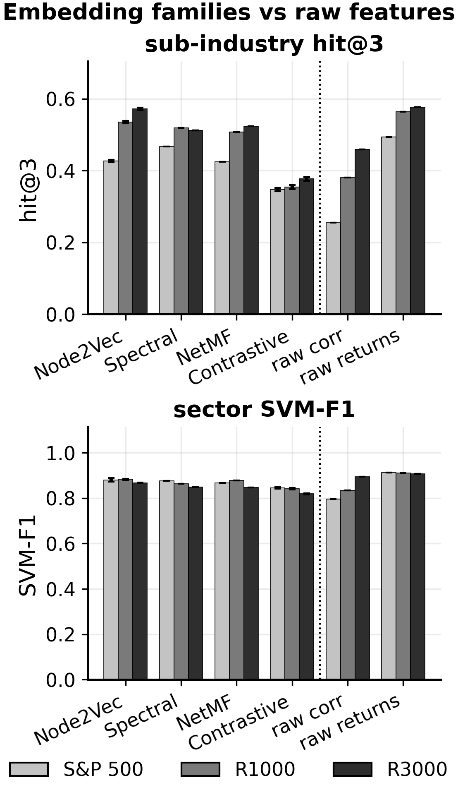

Grouped bars for the six representations (four learned embeddings | two no-embedding baselines) ×
three universes, on two metrics: **sub-industry hit@3** (retrieval, left) and **sector SVM-F1**
(supervised, right). The dotted line separates embeddings from raw features.

**Reads:** `raw_returns` is the tallest bar in *both* panels at *every* universe; the four learned
families (Node2Vec, spectral, NetMF, contrastive) all clear `raw_corr` on retrieval but sit *below*
`raw_returns`. This is the paper's central result — the "no embedding beats raw features" claim
holds against the strong return-series baseline and generalises across embedding families, not just
Node2Vec. Error bars are ±1 std over seeds (≈0 for the deterministic methods). *(RESULTS §6d.)*

## Figure 2 — The verdict is baseline-dependent (significance forest plot)
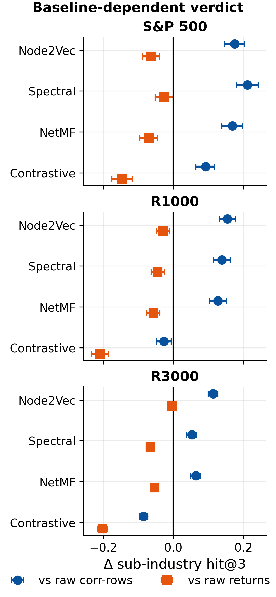

For each learned family, the paired-Wilcoxon **Δ(embedding − raw) in sub-industry hit@3** with its
95 % bootstrap CI, measured against each raw baseline (blue = vs `raw_corr`, orange = vs
`raw_returns`), one panel per universe. The vertical line is Δ = 0.

**Reads:** every blue point is to the **right** of 0 (embeddings significantly *beat* the leak-free
correlation-row baseline, +0.05…+0.21) while every orange point is to the **left** (they *lose* to
the return-series baseline). The single visual that makes "the answer depends entirely on which raw
baseline" unambiguous, and shows it holds at all three universe sizes. *(RESULTS §6d.)*

## Figure 3 — Robustness I: embedding dimension
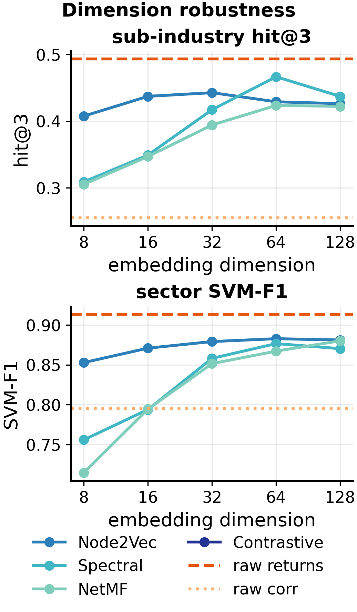

Sub-industry hit@3 (left) and sector SVM-F1 (right) versus embedding dimension (8 → 128, log axis)
for each learned family; the two raw baselines are dimension-free and drawn as horizontal reference
lines.

**Reads:** every embedding stays *between* the two raw baselines at every dimension ≥ 16. Node2Vec is
essentially flat; the spectral/matrix-factorisation families need d ≥ 32 to mature and then plateau.
So the headline comparison is not an artefact of the dim = 64 choice. *(RESULTS §6f.)*

## Figure 4 — Robustness II: Node2Vec p/q sensitivity
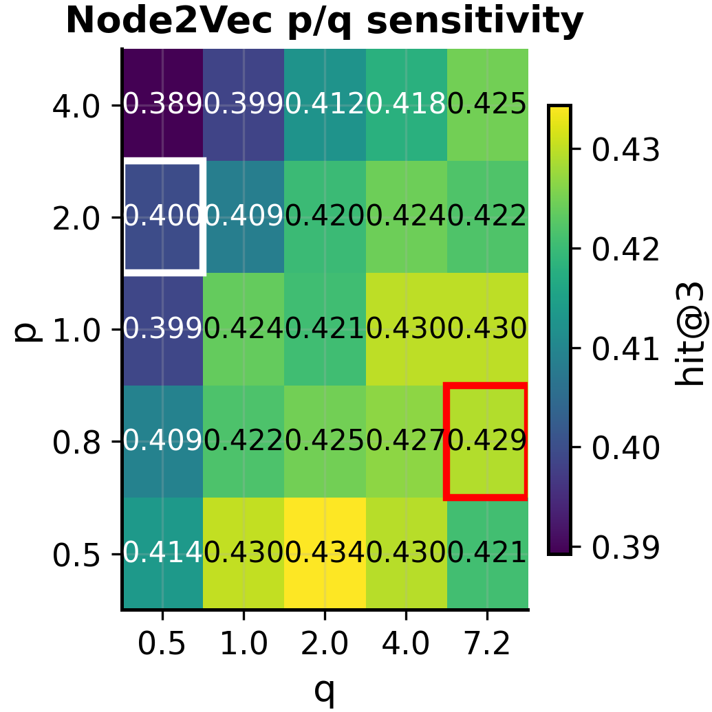

Heatmap of sub-industry hit@3 over the Node2Vec return/in-out parameter grid (p × q). Our config
(p = 0.8, q = 7.2) and Sarmah's (p = 2, q = 0.5) are boxed.

**Reads:** the entire grid spans only 0.389–0.434 (spread **0.045**); our config is *not* the peak,
and Sarmah's gives the same verdict. Because no grid point materially changes the result, the choice
of p/q cannot have leaked the test labels — the provenance concern is empirically void.
*(RESULTS §6f.)*

## Figure 5 — Temporal consistency (half/half split + rolling 1y/1y windows)
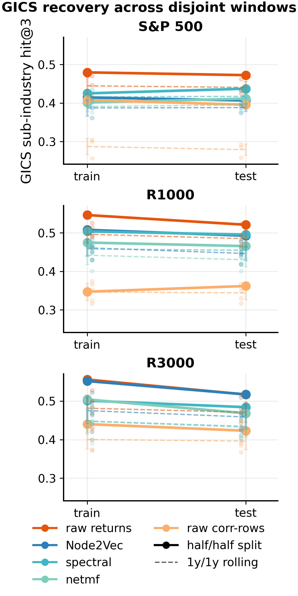

Slope chart: GICS sub-industry hit@3 for each representation, built on a train window and scored
on a disjoint test window. **Solid lines** = the half/half split (single A/B, window A ≤ 2023-06
vs window B > 2023-06); **dashed lines** = the mean over 3–5 rolling 1y/1y windows (error bars =
±1 std, faint dots = individual windows), one panel per universe.

**Reads:** the lines are nearly flat and never cross — each method recovers GICS about equally well
whether trained on the past or the future window, and the raw-vs-embedding ordering is preserved.
The rolling 1y/1y windows (dashed) confirm this is not a fluke of one split: the mean and spread
across multiple disjoint windows stay close to the diagonal. *(RESULTS §6e.)*

## Figure 6 — Out-of-sample: future co-movement of past neighbours (both configs)
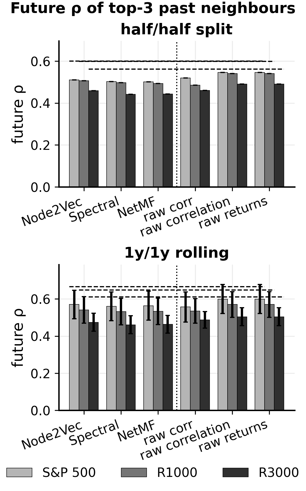

Two panels: **left** = half/half split (single A/B), **right** = 1y/1y rolling (mean ± std over
3–5 windows). For each representation, the **realised test-window correlation** of each stock's
top-3 train-window neighbours (grouped by universe); the dashed line is the oracle ceiling
(neighbours ranked by the test window's own correlation). Note three *distinct* no-model rankings
are shown separately and not conflated: **raw correlation (direct)** = rank by the correlation
matrix; **raw returns** = cosine of the standardized return series; **raw corr-rows** = cosine of
correlation-row vectors.

**Reads:** the two first-order rankings — **raw correlation (direct)** and **raw returns** — have the
highest future ρ in both panels; every learned embedding (and the second-order raw corr-rows) is
lower, and all methods retain ~80 % of their in-sample co-movement. The natural reviewer hypothesis
("the low-rank embedding should generalise better out of sample") is refuted across both the
half/half split and the rolling 1y/1y windows: raw features are not overfitting any more than the
embeddings. *(RESULTS §6e.)*

## Figure 7 — Dolphin benchmark leaderboard
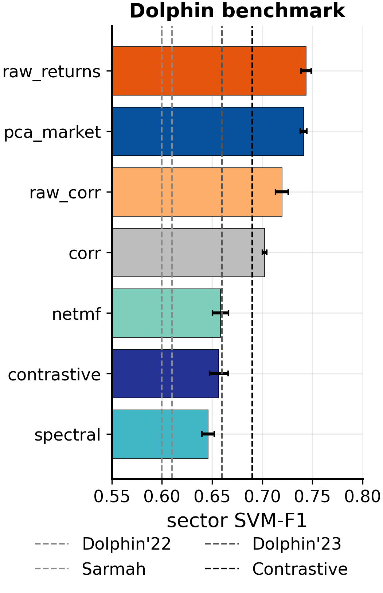

Horizontal bars: sector SVM-F1 on the reconstructed Dolphin 1,113-stock set (their exact 5-fold
protocol, dim 16), with their reported leaderboard numbers as vertical reference lines (Dolphin'22
0.60, Sarmah 0.61, Dolphin'23 0.66, Contrastive 0.69).

**Reads:** the leak-free raw baselines (`raw_corr` 0.72, `raw_returns` 0.74) sit *at or above* the
best learned embedding and *above* our reimplementation of the contrastive method — i.e. a
no-embedding baseline matches the contrastive SOTA's own published 0.69 on this universe. Everything
clusters in 0.65–0.78: the absolute level is a *universe artefact* (clean large-caps are easy), not a
method win. *(RESULTS §6b.)*

## Figure 8 — Metric disagreement: retrieval vs clustering
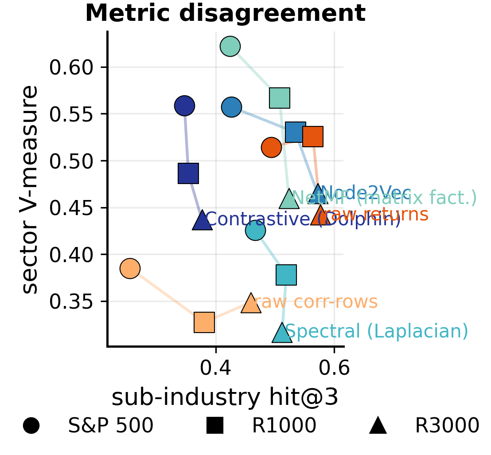

Scatter of each representation in the **retrieval (sub-industry hit@3, x) × clustering (sector
V-measure, y)** plane; colour = method, marker = universe, faint lines connect a method across
universes.

**Reads:** the plane has no top-right winner. The skip-gram-flavoured families (NetMF, Node2Vec,
contrastive) sit **high** (good clustering) but mid-retrieval; `raw_returns` sits **far right** (best
retrieval) at modest V-measure; `spectral` is high-retrieval / low-clustering. Which method "wins"
is entirely a function of which metric you privilege — the paper's metric-disagreement thesis in one
picture. *(RESULTS §6c–6d.)*

## Figure 9 — Co-movement removal pays off more at scale
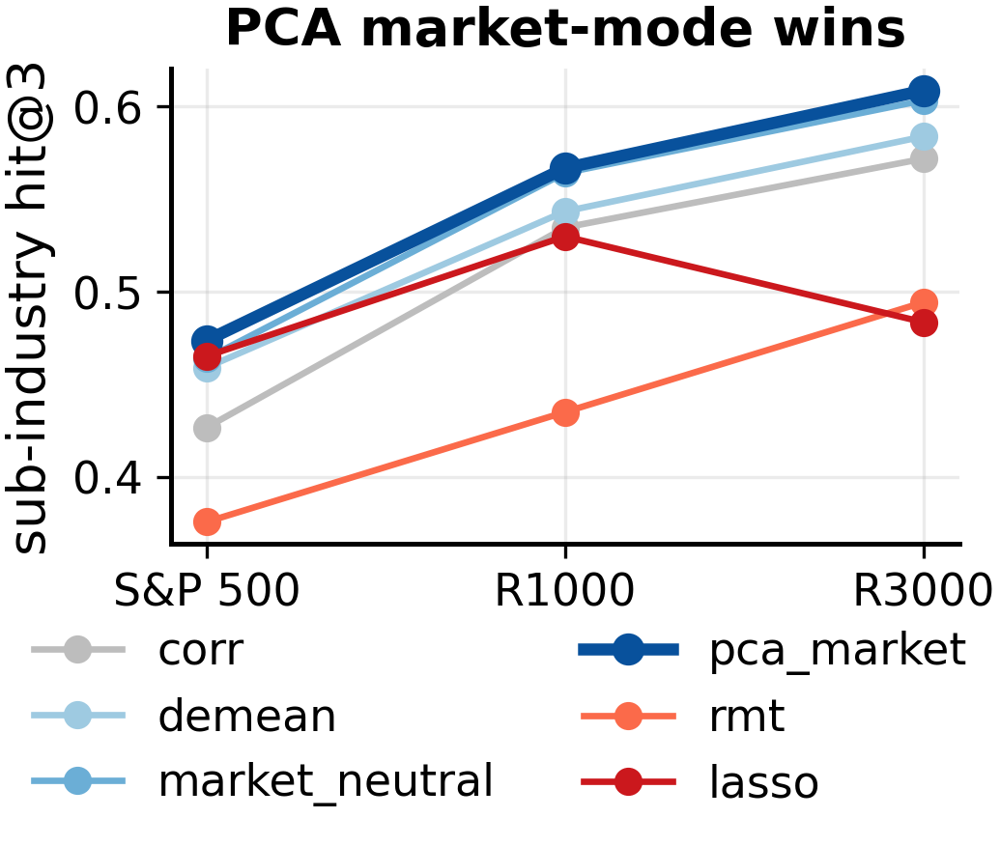

Sub-industry hit@3 of Node2Vec trained on six different relationship matrices (raw `corr`, `demean`,
`market_neutral`, `pca_market` ★, `rmt`, `lasso`) as the universe grows S&P 500 → R1000 → R3000.

**Reads:** `pca_market` (PCA market-mode removal, highlighted) is the best matrix and its advantage
over raw correlation *grows* with universe size; aggressive denoising (`rmt`, `lasso`) is worst.
Removing the common market factor helps more when there are more stocks sharing it. *(RESULTS §4.)*

## Figure 10 — Improving on Sarmah's network: density sweep
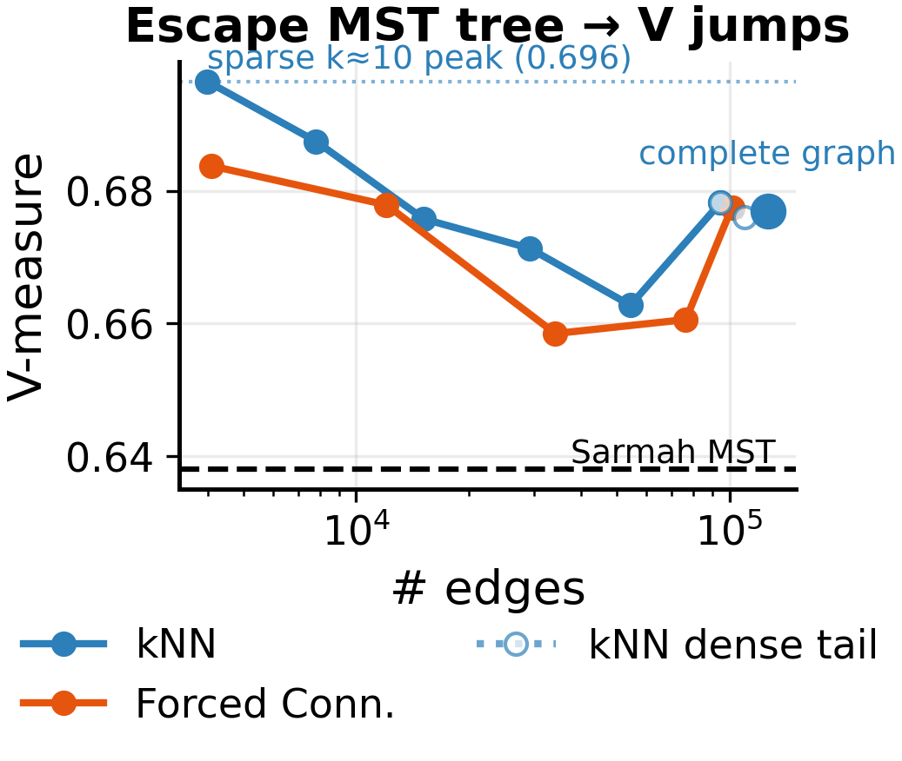

V-measure (averaged over the three aligned GICS levels) versus number of graph edges (log axis) for
kNN and Forced-Connectivity graphs built on Sarmah's exact 504-stock 2017 network; the dashed line is
Sarmah's MST baseline (503 edges, V = 0.638).

**Reads:** both graph families *beat* the MST baseline, and both **peak at the sparsest setting** then
decline as edges are added. The improvement over Sarmah is escaping the 503-edge *tree* into a
moderately connected graph (~4k edges) — not maximising density. *(RESULTS §6a-bis.)*

## Figure 11 — Why hit-rate is the primary metric
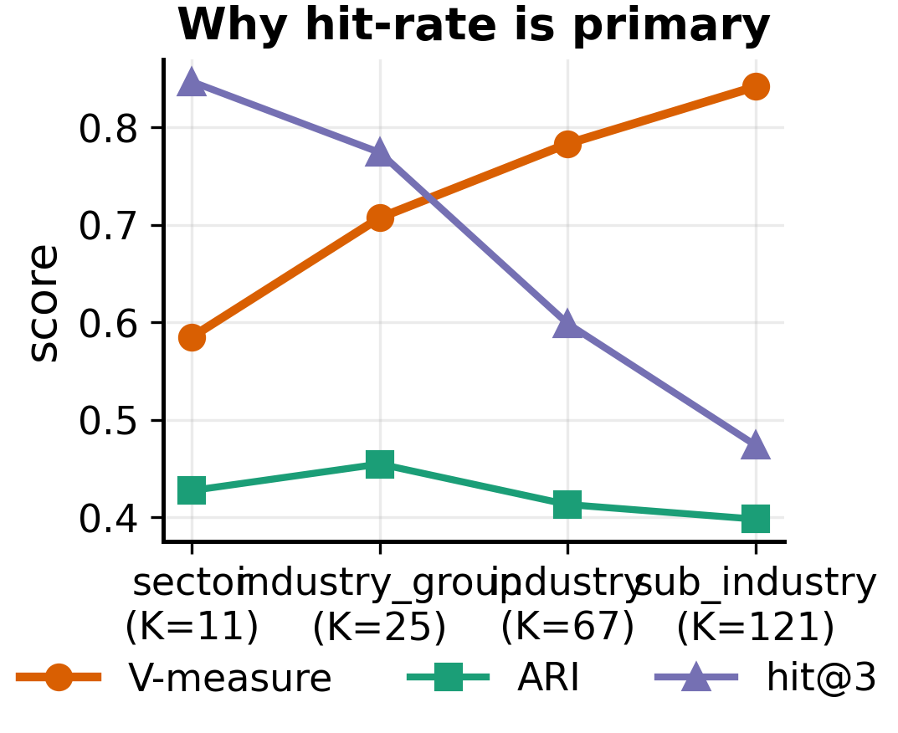

Three metrics for the *same* embedding (pca_market, S&P 500) as the GICS granularity gets finer
(K = 11 → 121 classes): V-measure, ARI, and retrieval hit@3.

**Reads:** V-measure *rises* with the number of classes while retrieval hit@3 *falls* and ARI stays
flat — the same embedding tells three different stories depending on the metric. Because V-measure
mechanically inflates at fine granularity, the parameter-free retrieval hit-rate is the paper's
honest headline metric. *(RESULTS §2.)*

## Figure 12 — Scorecard (no free lunch)
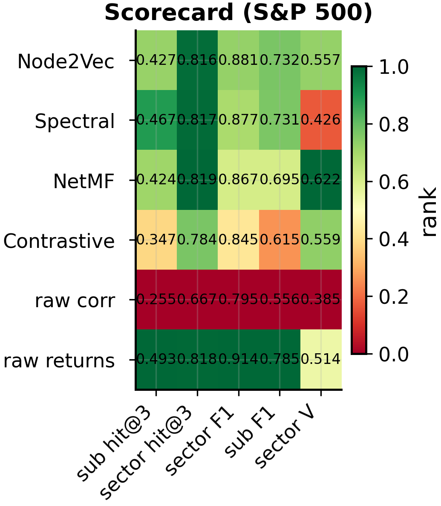

Heatmap of the six representations × five metrics on the S&P 500. Cell **colour** is the per-column
rank (green = best on that metric), the **number** is the actual score.

**Reads:** no row is green across the board. `raw_returns` is greenest on retrieval and supervised
F1; the skip-gram families are greenest on V-measure; `raw_corr` is worst on retrieval. A compact
companion to Figure 8 — every method is somebody's winner and somebody's loser. *(RESULTS §6d.)*
